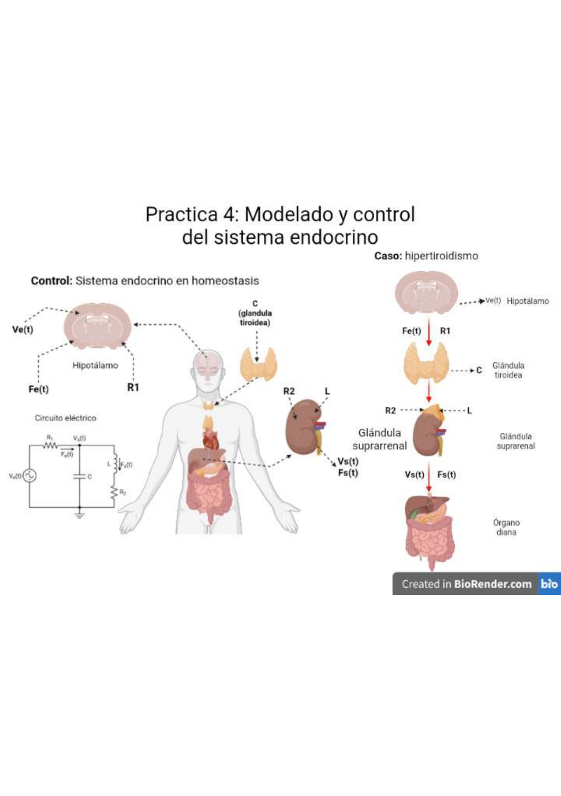
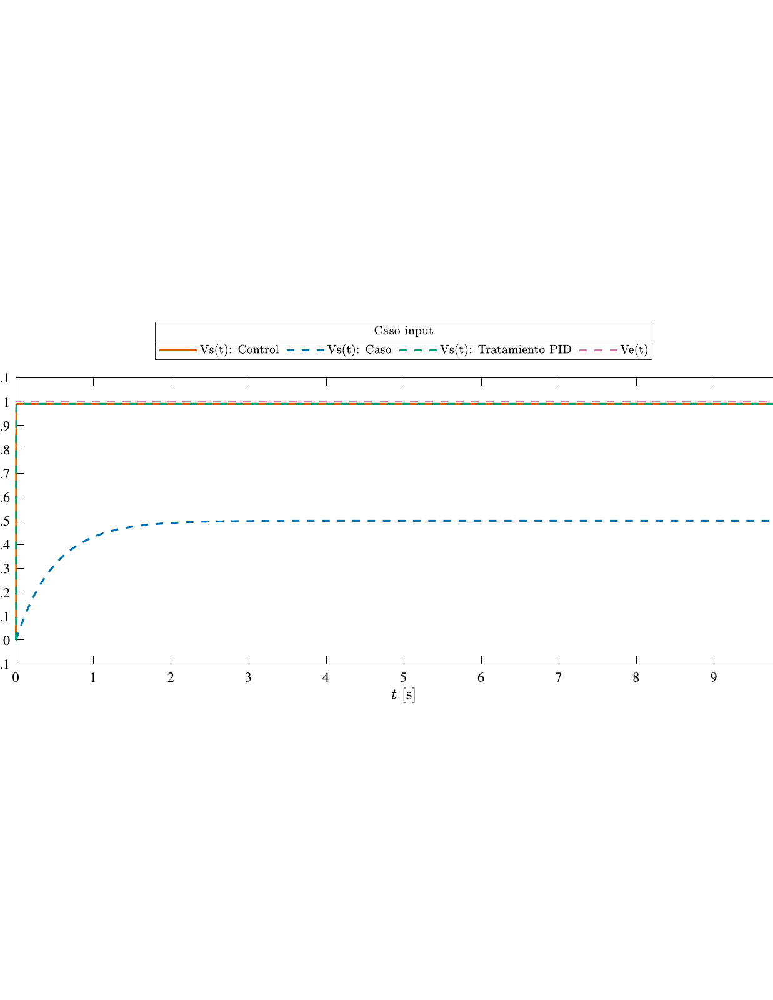
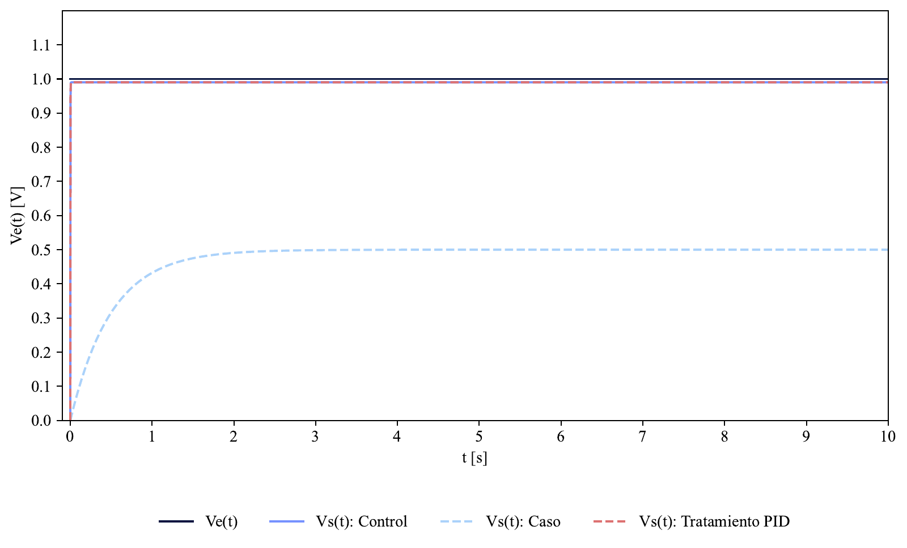
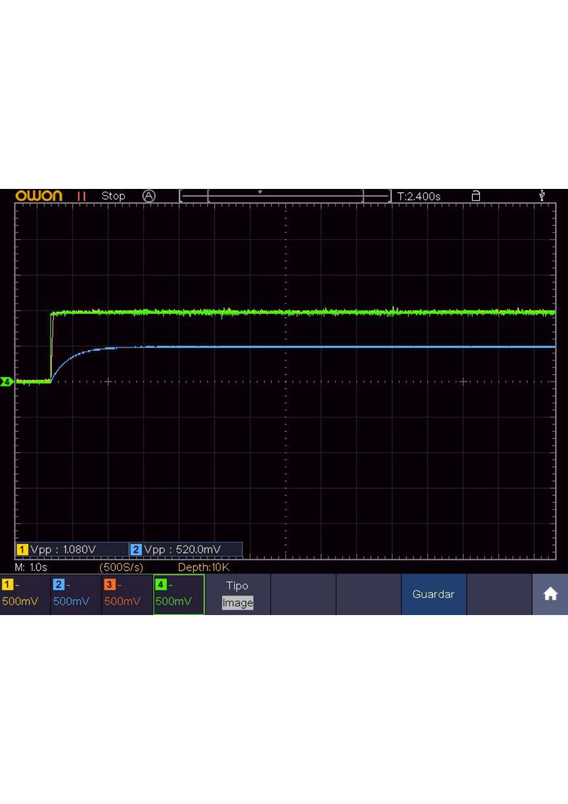

[](https://matlab.mathworks.com/)

# Práctica 4 — Modelado y control del sistema endócrino

Repositorio académico de **Modelado de Sistemas Fisiológicos (IBF-1020)**, del programa de **Ingeniería Biomédica** del Tecnológico Nacional de México / Instituto Tecnológico de Tijuana. El trabajo comprende la analogía eléctrica de un sistema endócrino, la formulación de una planta de segundo orden, la comparación de una condición **control** y una condición **caso**, la implementación de un controlador PID y la verificación mediante simulación y mediciones de laboratorio.

**Docente:** Dr. Paul Antonio Valle Trujillo  
**Correo:** paul.valle@tectijuana.edu.mx  
**Departamento:** Ingeniería Eléctrica y Electrónica  
**Institución:** Tecnológico Nacional de México / Instituto Tecnológico de Tijuana  
**Asignatura:** Modelado de Sistemas Fisiológicos  
**Programa:** Ingeniería Biomédica  
**Estudiante:** Osmar Ediel Armenta Medina  
**Número de control:** 23212178  
**Correo institucional:** l23212178@tectijuana.edu.mx  
**Repositorio de la asignatura:** https://github.com/DrPaulValle/MSF-IBF1020  
**Sede:** Blvd. Alberto Limón Padilla s/n, Tijuana, C. P. 22454, B. C., México.

---

<a id="contenido"></a>
## Contenido

1. [Resumen](#resumen)
2. [Competencia y objetivos](#objetivos)
3. [Relación con el temario](#temario)
4. [Modelo fisiológico y BioRender](#biorender)
5. [Analogía eléctrica y parámetros](#analogia)
6. [Formulación matemática](#modelo)
7. [Análisis de error y estabilidad](#analisis)
8. [Señal de entrada y simulación](#senales)
9. [MATLAB, Simulink y Simscape](#matlab)
10. [Control PID y lazo cerrado](#pid)
11. [Reproducción en Python](#python)
12. [Resultados y evidencia experimental](#resultados)
13. [Verificación cruzada](#verificacion)
14. [Estructura del repositorio](#estructura)
15. [Requisitos y reproducción](#requisitos)
16. [Conclusiones](#conclusiones)
17. [Referencias](#referencias)

---

<a id="resumen"></a>
## Resumen

Esta práctica analiza un modelo fenomenológico simplificado de secreción, transporte, almacenamiento y respuesta hormonal. La analogía eléctrica utiliza dos resistencias, una capacitancia y una inductancia para estudiar las diferencias dinámicas entre una condición de referencia y otra alterada. Se obtienen las funciones de transferencia, se comparan las respuestas a una entrada unitaria y se incorpora un controlador PID para aproximar la respuesta del caso a la del control. El trabajo reúne un cuaderno MATLAB, un modelo Simulink, un programa Python, un esquema en BioRender, gráficas y una captura de osciloscopio.

El diagrama BioRender ilustra **homeostasis** y un **caso etiquetado como hipertiroidismo**. Esta denominación es una interpretación gráfica del estudiante: el modelo eléctrico del instructivo es genérico y no valida por sí solo un diagnóstico o una fisiología específica de la tiroides.

**Palabras clave:** sistema endócrino; homeostasis; hipertiroidismo; analogía eléctrica; circuito RLC; función de transferencia; PID; MATLAB; Simulink; Simscape Electrical; Python; BioRender.

[Volver al contenido](#contenido)

---

<a id="objetivos"></a>
## Competencia y objetivos

### Competencia a desarrollar

Modelar sistemas fisiológicos mediante analogías eléctricas, ecuaciones diferenciales y funciones de transferencia; analizar su dinámica y diseñar estrategias de control clásico, contrastando simulaciones con evidencia experimental.

### Objetivo general

Modelar y comparar las respuestas de un sistema endócrino en condiciones control y caso, e implementar un controlador PID para reducir la diferencia entre ambas.

### Objetivos específicos

- Identificar las variables de entrada, salida y flujos en el circuito equivalente.
- Formular la función de transferencia de segundo orden para cada condición.
- Estudiar error estacionario, polos y estabilidad.
- Simular las respuestas en MATLAB/Simulink y Python.
- Aplicar retroalimentación negativa y documentar las ganancias del PID.
- Integrar la representación fisiológica y la evidencia de laboratorio.

[Volver al contenido](#contenido)

---

<a id="temario"></a>
## Relación con el temario

| Unidad | Contenido aplicado |
|---|---|
| I. Sistemas de control retroalimentados | Lazo abierto, lazo cerrado, respuesta temporal, error y estabilidad |
| II. Modelado matemático | Analogía eléctrica, leyes de Kirchhoff y funciones de transferencia |
| III. Controladores | Diseño y evaluación de un controlador PID |

[Volver al contenido](#contenido)

---

<a id="biorender"></a>
## Modelo fisiológico y BioRender

El sistema endócrino coordina procesos fisiológicos mediante la secreción de hormonas y su acción sobre tejidos diana. Para esta práctica se utiliza una representación simplificada de estímulo, transporte, almacenamiento y respuesta.

### Diagrama desarrollado en BioRender



*Figura 1. Diagrama original de BioRender: a la izquierda, sistema de control en homeostasis y circuito eléctrico equivalente; a la derecha, caso ilustrativo de hipertiroidismo. Se identifican Ve(t), Fe(t), Vs(t), Fs(t), R1, R2, C y L.*

[Ver archivo original en PDF](Biorender%20%28sistema%20endocrino%29.pdf)

> **Nota de alcance:** la analogía eléctrica del manual es fenomenológica. Los elementos del circuito no representan directamente órganos anatómicos ni concentraciones hormonales reales; el diagrama es una interpretación visual didáctica.

[Volver al contenido](#contenido)

---

<a id="analogia"></a>
## Analogía eléctrica y parámetros

La fuente de entrada **Ve(t)** se conecta en serie con **R1**. Después de R1 se encuentra el nodo **Vs(t)**, con una rama de capacitor **C** a tierra y otra rama formada por **L** y **R2** en serie a tierra.

| Variable | Representación en el modelo |
|---|---|
| Ve(t) | Estímulo de entrada para la secreción hormonal |
| Fe(t) | Flujo de secreción y transporte hormonal |
| R1 | Oposición efectiva al transporte |
| C | Almacenamiento temporal de la señal hormonal |
| L | Retardo o inercia de la respuesta |
| R2 | Utilización, disipación o eliminación de la señal |
| Fs(t) | Flujo asociado con la respuesta del órgano diana |
| Vs(t) | Nivel hormonal efectivo normalizado; variable de salida |

### Valores utilizados

| Parámetro | Control | Caso |
|---|---:|---:|
| R1 | 1 kΩ | 1 kΩ |
| L | 100 mH | 100 mH |
| C | 1 µF | 1000 µF |
| R2 | 100 kΩ | 1 kΩ |

Los valores se corresponden con los definidos en el archivo `codigo.py`. La variación simultánea de C y R2 permite estudiar los cambios en la dinámica del sistema.

[Volver al contenido](#contenido)

---

<a id="modelo"></a>
## Formulación matemática

### Ecuaciones integro-diferenciales

Aplicando las leyes de Kirchhoff a la topología descrita:

$$F_e(t)=C\frac{dV_s(t)}{dt}+F_s(t)$$

$$V_e(t)=R_1F_e(t)+V_s(t)$$

$$V_s(t)=L\frac{dF_s(t)}{dt}+R_2F_s(t)$$

Equivalente en forma de estados:

$$\frac{dV_s}{dt}=\frac{1}{C}\left(\frac{V_e-V_s}{R_1}-F_s\right)$$

$$\frac{dF_s}{dt}=\frac{V_s-R_2F_s}{L}$$

### Función de transferencia general

Para condiciones iniciales nulas:

$$\boxed{G(s)=\frac{V_s(s)}{V_e(s)}=\frac{Ls+R_2}{CL R_1s^2+(CR_1R_2+L)s+(R_1+R_2)}}$$

El numerador contiene **Ls + R2** y el denominador es de segundo orden, debido a la presencia de C y L.

### Funciones para las condiciones estudiadas

Con los parámetros de la tabla:

$$G_{control}(s)=\frac{0.1s+100000}{0.0001s^2+100.0001s+101000}$$

$$G_{caso}(s)=\frac{0.1s+1000}{0.1s^2+1000.1s+2000}$$

[Volver al contenido](#contenido)

---

<a id="analisis"></a>
## Análisis de error y estabilidad

### Error en estado estacionario

Para un escalón unitario y una planta estable, el valor final es G(0):

$$V_{s,control}(\infty)=\frac{100000}{101000}\approx0.9901$$

$$V_{s,caso}(\infty)=\frac{1000}{2000}=0.5$$

Por lo tanto, los errores de seguimiento de la entrada unitaria, **en lazo abierto**, son:

$$e_{ss,control}\approx0.0099,\qquad e_{ss,caso}=0.5$$

### Polos y estabilidad

Los polos se obtienen resolviendo:

$$CL R_1s^2+(CR_1R_2+L)s+(R_1+R_2)=0$$

Los coeficientes son positivos en ambas configuraciones; las plantas del modelo tienen polos con parte real negativa. La diferencia entre parámetros modifica la rapidez de la respuesta y el nivel final. La comparación visual aparece en las gráficas incluidas más adelante.

[Volver al contenido](#contenido)

---

<a id="senales"></a>
## Señal de entrada y condiciones de simulación

Se utiliza una **entrada escalón unitario**, `Ve(t) = 1`, sobre el intervalo de 0 a 10 segundos. Aunque el encabezado del cuaderno MATLAB dice «Respuesta al impulso», el código Python usa `np.ones(N)` y las figuras muestran un escalón; por ello se describe aquí como respuesta al escalón.

| Parámetro | Valor |
|---|---|
| Tiempo inicial | 0 s |
| Tiempo final | 10 s |
| Paso temporal en Python | 1 × 10⁻³ s |
| Solver en MATLAB/Simulink | `ode15s` |
| Paso máximo en Simulink | `1e-3` s |
| Entrada | Escalón de amplitud 1 |

[Volver al contenido](#contenido)

---

<a id="matlab"></a>
## Implementación en MATLAB, Simulink y Simscape

El cuaderno [`Armenta23212178.mlx`](Armenta23212178.mlx) ejecuta el modelo [`sistema(3).slx`](sistema%283%29.slx) y representa las respuestas del control, caso, tratamiento PID y entrada. El cuaderno emplea la configuración siguiente:

```matlab
clc; clear; close all; warning('off','all')
open_system('sistema')
parameters.StopTime = '10';
parameters.Solver = 'ode15s';
parameters.MaxStep = '1e-3';
x = sim('sistema',parameters);
plotsignals(x.control,x.CE,x.PID,x.Ve,'Caso')
```

**Importante:** el archivo adjunto se llama `sistema(3).slx`, pero el cuaderno invoca `sistema`. Para reproducirlo sin modificar el cuaderno, renombrar una copia del archivo a `sistema.slx` antes de ejecutar. El archivo original se conserva en este repositorio.

### Respuesta obtenida en MATLAB



*Figura 2. Respuestas de la simulación del cuaderno MATLAB, de 0 a 10 s.*

[Ver gráfica original](grafica%20cuadernillo.pdf) · [Ver reporte del cuaderno](Armenta23212178.pdf)

[Volver al contenido](#contenido)

---

<a id="pid"></a>
## Control PID y lazo cerrado

La respuesta de la condición control se utiliza como referencia para corregir la respuesta del caso. La diferencia entre ambas es:

$$e(t)=V_{s,control}(t)-V_{s,caso}(t)$$

El controlador ideal se expresa como:

$$K(s)=k_P+\frac{k_I}{s}+k_Ds$$

En el programa Python entregado se emplearon estas ganancias:

| Ganancia | Valor |
|---|---:|
| kP | 13209.9564 |
| kI | 32316525.9285 |
| kD | 0.18118 |

El código también construye una realización racional del controlador a partir de componentes analógicos:

```python
Cr = 1E-6
Re = 1/(Cr*kI)
Rr = kP*Re
Ce = kD/Rr
numPID = [Re*Rr*Ce*Cr, Re*Ce+Rr*Cr, 1]
denPID = [Re*Cr, 0]
PID = ctrl.tf(numPID, denPID)
sysPID = ctrl.feedback(ctrl.series(PID,sysCaso),1,sign=-1)
```

En Python, `Tratamiento = closedloop(t,sysPID,Control)` utiliza la respuesta control como referencia. Así, el resultado no equivale a alimentar el lazo cerrado directamente con un escalón unitario; esta distinción es importante para interpretar la gráfica.

[Volver al contenido](#contenido)

---

<a id="python"></a>
## Reproducción en Python

El archivo [`codigo.py`](codigo.py) utiliza **NumPy**, **python-control** y **Matplotlib** para construir las funciones de transferencia, calcular las respuestas forzadas, implementar la retroalimentación negativa y exportar la gráfica.

Fragmento de las funciones de transferencia utilizadas:

```python
def sis(C, R2, nombre):
    R1, L = 1E3, 100E-3
    num = [L, R2]
    den = [C*L*R1, C*R1*R2+L, R1+R2]
    sys = ctrl.tf(num, den)
    print(f"Función de transferencia {nombre}: {sys}\n")
    return sys

sysControl = sis(1E-6, 100E3, "Control")
sysCaso = sis(1000E-6, 1E3, "Caso")
```

### Respuesta obtenida en Python



*Figura 3. Comparación numérica de Ve(t), Vs(t) control, Vs(t) caso y Vs(t) tratamiento PID.*

[Ver gráfica original](grafica%20python.pdf)

[Volver al contenido](#contenido)

---

<a id="resultados"></a>
## Resultados y evidencia experimental

### Comparación de respuestas

Las gráficas de MATLAB y Python muestran que el sistema **control** se aproxima a una salida cercana a 1, mientras que el **caso** alcanza aproximadamente 0.5. Con el controlador PID, la respuesta del caso se acerca a la referencia de control en las simulaciones documentadas.

| Respuesta | Comportamiento observado |
|---|---|
| Entrada Ve(t) | Escalón unitario |
| Control | Respuesta rápida, valor final cercano a 0.99 |
| Caso | Ascenso más lento y valor final cercano a 0.50 |
| Tratamiento PID | Aproximación de la respuesta del caso a la referencia |

### Captura del osciloscopio



*Figura 4. Evidencia experimental registrada con osciloscopio OWON. La pantalla muestra una transición de entrada y una respuesta de salida de ascenso gradual; se visualizan las lecturas Vpp de 1.080 V y 520.0 mV.*

[Ver captura original](Screenshot%20osciloscopio.pdf)

La captura permite observar una dinámica compatible cualitativamente con el sistema alterado. No se reportan tolerancias de componentes, repetición de ensayos ni calibración instrumental en los archivos suministrados; por ello no se presenta una validación cuantitativa adicional.

[Volver al contenido](#contenido)

---

<a id="verificacion"></a>
## Verificación cruzada

Se comparan los resultados de la función de transferencia, el cuaderno MATLAB, el programa Python y la medición con osciloscopio. Las dos gráficas computacionales reproducen la separación entre control y caso y muestran el efecto del tratamiento PID. La evidencia experimental documenta una entrada de tipo escalón y una respuesta con transición gradual. Las diferencias de escalas, componentes no ideales y condiciones de medición deben considerarse antes de establecer equivalencia numérica exacta.

[Volver al contenido](#contenido)

---

<a id="estructura"></a>
## Estructura del repositorio

```text
Practica4_Endocrino/
├── analisis matematico.pdf
├── Armenta23212178.mlx
├── Armenta23212178.pdf
├── sistema.slx
├── codigo.py
├── controlador PID.jpeg
├── biorender.png
├── matlab.png
├── python.png
└── osciloscopio.png

```

Las imágenes PNG están integradas mediante rutas relativas para que se visualicen automáticamente en GitHub, siempre que los archivos PNG se suban al mismo nivel que `README.md`.

[Volver al contenido](#contenido)

---

<a id="requisitos"></a>
## Requisitos y reproducción

**Software:** MATLAB con Simulink y los complementos requeridos por el modelo `.slx`; Python 3 con `numpy`, `matplotlib` y `control`; lector de PDF. Simscape Electrical es necesario si se desea ejecutar las partes del modelo construidas con componentes físicos de esa biblioteca.

Para instalar las dependencias de Python:

```bash
python -m pip install numpy matplotlib control
```

Para reproducir los resultados, colocar los archivos en una misma carpeta, renombrar una copia de `sistema(3).slx` a `sistema.slx`, ejecutar el cuaderno MATLAB y correr `python codigo.py`. Revisar que los bloques del modelo estén disponibles en la instalación local. La salida de Python se guarda como `Control_caso_python4.pdf` según el código original.

[Volver al contenido](#contenido)

---

<a id="conclusiones"></a>
## Conclusiones

El circuito eléctrico de segundo orden permite estudiar de manera simplificada el comportamiento dinámico de una señal hormonal. Las modificaciones de capacitancia y resistencia entre el control y el caso alteran la rapidez de respuesta y el valor estacionario. Las gráficas obtenidas mediante MATLAB y Python muestran que el controlador PID reduce la diferencia entre la respuesta alterada y la referencia. La evidencia de osciloscopio complementa la simulación al mostrar la transición temporal de una señal real. El modelo es útil como ejercicio académico de control, pero no constituye una representación clínica validada de un trastorno endocrino específico.

[Volver al contenido](#contenido)

---

<a id="referencias"></a>
## Referencias

1. Valle Trujillo, P. A. (2026). *Modelado de Sistemas Fisiológicos (IBF-1020)*, apartado 5.6, «Práctica: Modelado y control del sistema endócrino». Instituto Tecnológico de Tijuana.
2. Valle Trujillo, P. A. *README de referencia: Práctica 0 — Modelo de mecánica pulmonar de segundo orden*. Material proporcionado por el docente.
3. Armenta Medina, O. E. *Armenta23212178.mlx*, *codigo.py*, *sistema(3).slx*, resultados gráficos, captura de osciloscopio y diagrama BioRender. Archivos de la práctica.
4. Repositorio de la asignatura: https://github.com/DrPaulValle/MSF-IBF1020

[Volver al contenido](#contenido)
